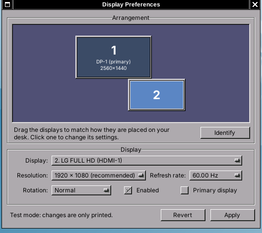

# wdisplay

A monitor manager for [Window Maker](https://www.windowmaker.org/), built
with WINGs so it looks and feels like WPrefs.

- **Arrangement:** drag the displays to match where they sit on your desk,
  like in the Windows display settings. Dropped displays snap against their
  neighbours (edges and centres align), so there are never gaps or overlaps.
- **Resolution, refresh rate and rotation** for each display, plus turning
  displays on/off and choosing the primary one.
- **Identify** shows each display's number on the screen itself.
- **Apply** switches to the new settings and asks you to confirm them. If
  you don't confirm within 15 seconds (for example, because the screen went
  black), the old settings come back.
- **Saved for good:** confirmed settings are stored per set of connected
  monitors, and restored every time Window Maker starts. Plug in a different
  set of monitors and that set gets its own layout.



## Building

You need the WINGs, Xrandr and X11 development files, and the `xrandr`
program at runtime.

```sh
# Debian / Ubuntu
sudo apt install build-essential pkg-config libwings-dev libxrandr-dev x11-xserver-utils
# Arch
sudo pacman -S windowmaker libxrandr xorg-xrandr
# Fedora
sudo dnf install WINGs-devel libXrandr-devel xrandr

make
sudo make install        # to /usr/local; use PREFIX=... to change
```

Then run `wdisplay`, or add it to the Window Maker root menu (WPrefs → Menu,
add a "Run Program" entry with `wdisplay`) or drag it into the Dock.

## How the settings are kept

When you press **Apply** and then **Keep Changes**, wdisplay:

1. stores the layout in `~/GNUstep/Defaults/WDisplay` (a normal Window
   Maker property list), under a key made of the names of the connected
   outputs, such as `"DP-1+HDMI-1"`;
2. adds this block to `~/GNUstep/Library/WindowMaker/autostart`, creating
   the script if needed:

   ```sh
   # >>> wdisplay: restore the saved monitor layout >>>
   if [ -x '/usr/local/bin/wdisplay' ]; then '/usr/local/bin/wdisplay' --restore; fi
   # <<< wdisplay <<<
   ```

`wdisplay --restore` looks up the layout for the monitors connected at that
moment and applies it with xrandr. `wdisplay --print` shows the command it
would run. If you don't start Window Maker through its autostart (or want the
layout before the window manager starts), put `wdisplay --restore` in your
`~/.xinitrc` or `~/.xsession` instead.

`WMAKER_USER_ROOT` is honoured just like Window Maker does.

## Trying it without changing anything

```sh
WDISPLAY_FAKE=1 ./wdisplay      # a made up 3 monitor setup; commands are only printed
WDISPLAY_DRY_RUN=1 ./wdisplay   # your real monitors; xrandr commands are only printed
```

## License

GPL-2.0-or-later, like Window Maker.
